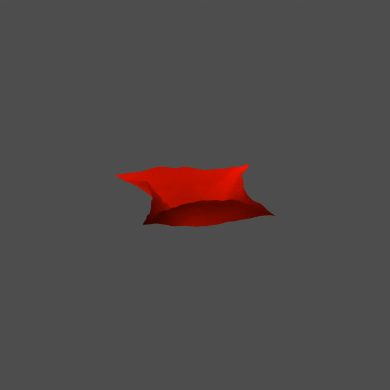

<!--
    AI impact: reworked by Claude from the author's draft; later restructured by
    Claude — demo link, opening section, performance section, stability section
    rewritten from the constants comment in src/main.js.
    Performance tables filled in by Claude from its own measurements
    Human review: approved.
-->

# Textile-Wave

Real-time XPBD cloth simulation running entirely in WebGPU compute shaders.
Plain JavaScript: no engine, no libraries, no build step.

**[Live demo](https://igor-polev.github.io/textile-wave/)** — requires a browser
with WebGPU: Chrome or Edge 113+, or another Chromium-based browser with WebGPU
enabled.



A square piece of cloth is held at its four corners while a vertex at its centre
is driven up and down as a sine wave. Both stages of the physics — position
prediction and the constraint solve — run on the GPU, one compute pass each, for
every substep of every frame. The CPU only measures frame time, adjusts the
substep count and encodes the passes.

The physical model is kept minimal on purpose: distance constraints and nothing
else. The work here is in the solver and the time stepping, not in the material.

## Usage

The shaders are loaded with `fetch`, so a local copy must be served over HTTP.
Opening `index.html` as a file will not work.

```sh
python3 -m http.server 8000
```

Then open <http://localhost:8000>.

The **Gravity on/off** checkbox in the top-left corner switches gravity. The
model parameters — mesh size, mass, compliance, wave amplitude and speed, camera
angles — are constants at the top of `src/main.js`.

## Implementation details

- **Mesh:** a regular grid of particles. Each particle is joined to its
  8 neighbours by distance constraints: 4 along the grid edges and
  4 along the diagonals.
- **Fixed and driven particles:** the four corners and the driving vertex have
  zero inverse mass, so the constraints do not move them.
- **Time stepping:** as in *Small Steps*, each frame is split into n substeps,
  with one XPBD iteration per substep. The frame time step is the measured time
  between frames. The number of substeps adapts to the GPU time budget of a
  frame and stays within fixed limits.
- **Solver:** a parallel Jacobi iteration. One compute pass predicts the
  positions; a second pass solves the constraints of each particle against
  these predictions and updates the positions and velocities. Each constraint is
  therefore evaluated twice per substep, once from each of its two endpoints.
- **Rendering:** the cloth is drawn as a triangle mesh with a depth buffer,
  coloured by depth, on a square canvas.

## Performance

The substep count is not fixed: the render loop measures how long a frame
actually costs and keeps the substep count at the largest value that still fits
into 80% of the frame at the target frame rate. The numbers below therefore say
how much constraint solving this implementation fits into one frame.

Measured on 2026-10-21.

**Test bench**

| | |
| :-- | :-- |
| GPU | NVIDIA GeForce RTX 3080 (Ampere) |
| Driver / Mesa version | NVIDIA 560.94 (32.0.15.6094) |
| CPU | Intel Core i5-3570K, 4 cores, 3.4 GHz |
| Browser and version | Microsoft Edge 135.0.3179.66 (Chromium 135) |
| OS | Windows 11 Pro N 23H2, build 22631.6199 |
| Display refresh rate | 120 Hz |
| Canvas size, px | 1024 × 1024 |
| Device pixel ratio | 1 |

**Throughput against mesh size.** Steady state, gravity on, `TARGET_FPS = 60`,
`COMPLIANCE` at its default. The frame rate is set by the display, not by
`TARGET_FPS`, so FPS is 120 throughout. *Wall time per substep* is the app's
own `timePerSubstep`; *GPU time per substep* is the compute pass measured with
timestamp queries, divided by the substep count.

| `MESH_SIZE` | Particles | Constraints | Substeps / frame | FPS | Wall time per substep, ms | GPU time per substep, µs | Particle updates / s | Constraint evaluations / s |
| ---: | ---: | ---: | ---: | ---: | ---: | ---: | ---: | ---: |
| 21 | 441 | 1 640 | 200 | 120 | 0.034 | 10 | 10.6 M | 78.7 M |
| 31 | 961 | 3 660 | 200 | 120 | 0.035 | 10 | 23.1 M | 176 M |
| 51 | 2 601 | 10 100 | 200 | 120 | 0.035 | 11 | 62.4 M | 485 M |
| 71 | 5 041 | 19 740 | 200 | 120 | 0.035 | 11 | 121 M | 948 M |
| 101 | 10 201 | 40 200 | 200 | 120 | 0.034 | 13 | 245 M | 1.93 G |

The two derived columns:

- *particle updates / s* = particles × substeps × FPS;
- *constraint evaluations / s* = 2 × constraints × substeps × FPS, the factor 2
  because the Jacobi pass evaluates every constraint from both of its endpoints.

The substep count sits at `MAX_SUBSTEPS`: the GPU needs about 2 ms of the
8.3 ms frame for 200 substeps. The adaptive controller does not see this. Its
wall-clock measure is mostly the latency of `onSubmittedWorkDone()`, 7–25 ms
per frame, not the cost of the work. In 9 of 20 runs, at every mesh size, the
controller locked at `MIN_SUBSTEPS = 50` instead: a latency of 17 or 25 ms
per frame gives a substep time of 0.34–0.50 ms, so the count stays at the
floor. All throughput figures are then a quarter of the table, at the same
120 FPS. Which state a run ends in is decided at start-up; it does not depend on
the mesh size. When the cap is lifted (`MAX_SUBSTEPS = 100000`), runs that
escape the floor settle at about 680 substeps per frame.

**Stable substep window.** The lower bound is where the Jacobi iteration stops
converging within a substep; the upper bound is where f32 precision runs out
(*Small Steps*, section 7). `MIN_SUBSTEPS` and `MAX_SUBSTEPS` in `src/main.js`
are set from this window. The counts below are substeps per 1/60 s frame; at
another frame rate they scale with the frame time.

| `COMPLIANCE` | Lowest stable substeps | Highest stable substeps |
| ---: | ---: | ---: |
| 0.02 | 10 | 352 |
| 0.08 | 6 | 416 |
| 0.20 | 4 | 256 |

Below the lowest count every particle becomes NaN and the cloth vanishes; the
first one or two counts above it still oscillate more than the rest. Above the
highest count the cloth does not blow up, but it no longer follows the
simulation: it sags less, its surface becomes noisy, and from about 1 000
substeps the per-vertex noise is clearly visible.

**What the frame is spent on.** Two dispatches per substep means
2 × substeps × FPS compute dispatches per second.

| | |
| :-- | :-- |
| Dispatches / s at `MESH_SIZE = 51` | 48 000 (200 substeps × 120 FPS × 2); 12 000 when locked at 50 substeps |
| Limiting factor | Neither GPU memory traffic nor CPU encoding: the substep cap, or the controller locked at the floor. The GPU is busy about 2 ms per frame, and JS encoding takes about 0.2 ms. GPU time per substep hardly grows from 441 to 10 201 particles, so the GPU part is per-dispatch overhead, not memory traffic. |

*How the numbers are taken:* an instrumented copy of the app, driven by
Playwright in a visible Edge window. The copy takes its constants from URL
parameters, adds timestamp queries around the compute pass and reads the
particle buffer back; the physics and the render loop are unchanged.

- Throughput: 15 s warm-up, then 8–10 s of frame records; each mesh size was
  run four times. Wall time per substep is the mean of the per-frame
  `timePerSubstep` input; GPU time is the median of the timestamp samples.
- Stability: a fixed frame step of 1/60 s and a fixed substep count. A count
  is stable at the low end if no value is NaN after 30 s of simulated time
  (counts 2–20 tested). At the high end, after 10 s the shape is compared with
  a reference run well inside the window (128, 64 and 32 substeps for the three
  compliances). The highest stable count is the last tested count before the
  first one whose RMS distance from the reference exceeds 3.5 cm, about
  2.5 mesh steps. Counts were tested in steps of 32 from 128 to 512.

## Numerical stability

The simulation stays stable only inside a window of substep counts, and the
window depends on compliance, mass and mesh step.

- **Too few substeps** and the Jacobi iteration does not converge inside a
  substep: one iteration per substep is enough only while the substep is short
  enough. The mesh then distorts and blows up.
- **Too many substeps** and the time step becomes small enough that f32
  precision limits the position update (*Small Steps*, section 7). Errors
  accumulate instead of shrinking.

`MIN_SUBSTEPS` and `MAX_SUBSTEPS` keep the adaptive controller inside that
window for the default parameters at 60 FPS. Changing `COMPLIANCE`,
`PARTICLE_MASS`, `MESH_SIZE` or `TARGET_FPS` moves the window, and a
combination outside it shows up as a distorted or vanished cloth. Reloading the
page restarts from the initial state.

## Math involved

- [XPBD: Position-Based Simulation of Compliant Constrained Dynamics](https://matthias-research.github.io/pages/publications/XPBD.pdf) (Macklin, Müller, Chentanez, 2016);
- [Small Steps in Physics Simulation](https://matthias-research.github.io/pages/publications/smallsteps.pdf)
  (Macklin et al., 2019), the substep modification of XPBD.
  The shader comments refer to it as `_SSX_`.

## Scope

Distance constraints are the only constraints: there is no damping, no bending
stiffness, no friction and no collision detection. Self-collision in particular
is what separates a solver demonstration from a usable cloth simulation.

## Known Issues

Some combination of parameters can make calculation scheme unstable (distorted or 
disappeared image). In such a case refresh the app page in your browser (press F5
or Ctrl+r).

## Project structure

| File               | Contents                                          |
| :----------------- | :------------------------------------------------ |
| `index.html`       | the page: canvas and UI                           |
| `style.css`        | page styles                                       |
| `src/main.js`      | WebGPU setup, buffers, pipelines, render loop, UI |
| `src/compute.wgsl` | physics: prediction and XPBD constraint solve     |
| `src/render.wgsl`  | vertex and fragment shaders                       |
| `claude-log.md`    | log of the AI assistant usage                     |

## Dependencies

None at runtime: plain JavaScript, HTML and CSS, with no libraries and no build
step. `npm install` is only needed for the WebGPU type hints in the editor
(`@webgpu/types`).

## AI usage disclosure

The physical model, the solver, the time-stepping scheme and the WebGPU
pipeline design are the author's. An AI assistant was used under the rules in
`CLAUDE.md`, and the full prompt-by-prompt record is in `claude-log.md`: most
entries there are reviews that changed no code. What the assistant did write is
the initial page skeleton, adapted from the `webgpu-samples` hello-triangle
sample, one rewrite of the render loop and the substep limits, and spelling
fixes in comments. Every file it touched says so in its header comment.

## License

MIT, see `LICENSE`.
